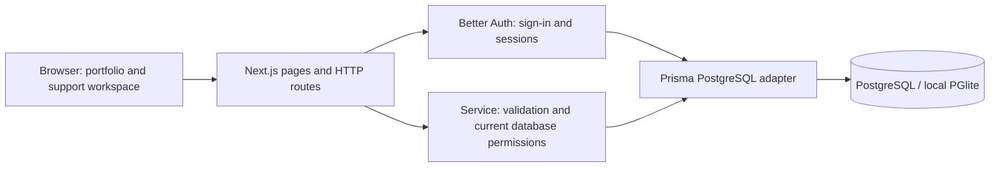

# Architecture

## Components

- Public pages: `/`, `/case-study`, `/login`.
- Workspace: `/desk`; query parameters choose queue, assigned tickets, creation, detail, or administration.
- `/api/auth/*`: Better Auth handlers, including sign-in, get-session, and sign-out.
- `/api/bootstrap`: current user, active categories, scoped dashboard, and admin-only agent choices.
- `/api/tickets`: scoped search/list and validated creation.
- `/api/tickets/[id]`: scoped detail and allowlisted mutations.
- `/api/admin`: administrator-only reads and mutations.
- `src/lib/service.ts`: reusable database operations and permission enforcement, directly tested.
- `src/lib/http.ts`: session identity, JSON errors, and same-origin mutation checks.

## Relationships

User has Sessions and Accounts for authentication. A Ticket belongs to one requesting User and one Category, and optionally one assigned staff User. Ticket has Messages and Activities. Messages have an author and a private/internal flag. Activities have an actor and optional ticket; category and role administration records are not exposed through requester history.

## Authentication and boundaries

Passwords are hashed by Better Auth. Session tokens are stored in database-backed sessions and sent through library-managed HTTP-only cookies. The server gets user identity from the session, then re-reads the role from the User table. No role or ownership claim sent by the browser is trusted. Cookie session caching is disabled. Registration is disabled; only the explicit development seed creates demonstration accounts.

Browser writes require the configured origin and JSON content type. Zod validates allowlisted fields. Database uniqueness protects category names. SQL row locks serialize updates to the same ticket. The ticket change and activity record share a transaction so failed changes do not leave a false history entry. User text is rendered by React as text, not HTML.

## Ticket lifecycle

Creation → Open → support assignment and status updates → Resolved with explanation. A resolved ticket can reopen to Open with a reason. Public replies remain visible to the requester; internal notes are fetched only for support roles. Dashboard counts are database group counts, scoped to ownership for requesters.

## Operational limits

The development PGlite socket server uses a single PostgreSQL engine with connection multiplexing. It is useful for local functional checks; ordinary PostgreSQL must be verified separately before production. Rate limiting is in memory and needs shared storage when scaling. No email or external AI service is called.
