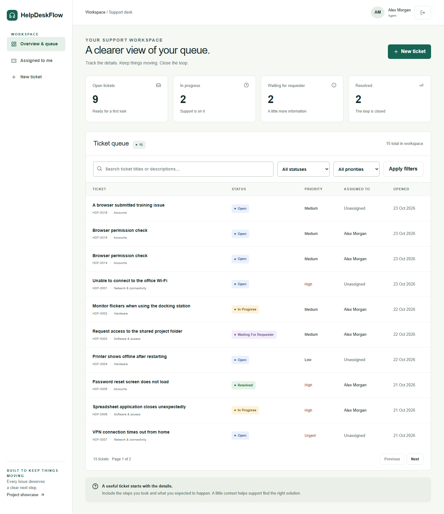
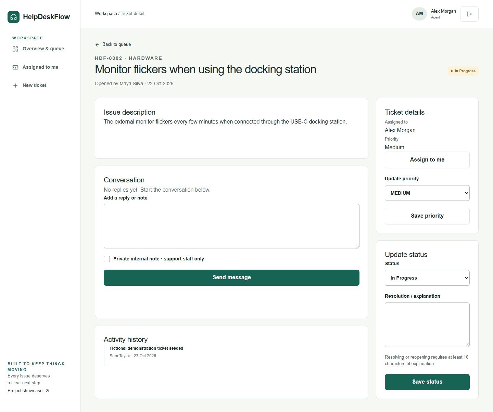
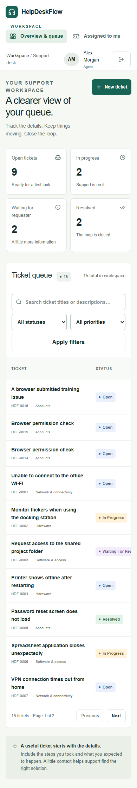

# User guide

Open the local address printed by the application, normally http://127.0.0.1:3000. The public showcase is separate from the protected workspace. Use the private development credentials supplied in `.local/demo-credentials.json`. Never share privileged passwords publicly.

## Requester

1. Select Open workspace, then sign in using the requester account.
2. Select New ticket. Give a specific title, useful description, category, and priority.
3. Submit and open the detail. Use the reply form to add context.
4. Check the status and public activity history. Only your own tickets appear.
5. After resolution, read the explanation. If the issue returns, enter a reopening reason and select Reopen ticket.
6. Use the sign-out button beside your profile when finished.

## Support agent

Search the queue, choose status/priority filters, and select Apply filters. Use Previous and Next for pages of ten tickets. Select a title to open it. Assign to me claims ownership; Assigned to me shows your assigned queue. Save priority and Save status update the ticket. Enter an explanation when resolving. The private internal note checkbox limits a message to staff; leave it unchecked for a public requester reply.

## Administrator

Use Administration to add categories, archive/restore them, and update other people's roles. Archiving preserves existing tickets. Your own role cannot change through this interface. Changing another user's role ends their sessions. Reassign an agent's tickets before demoting them to requester. On a shared demo, management is deliberately disabled. Ticket detail also allows assignment to a selected staff member.

## Mobile

Navigation moves above the workspace. Ticket tables can scroll within their panel. All forms remain labelled, and statuses use words as well as colour. Do not put real personal or company information into demonstration tickets.
